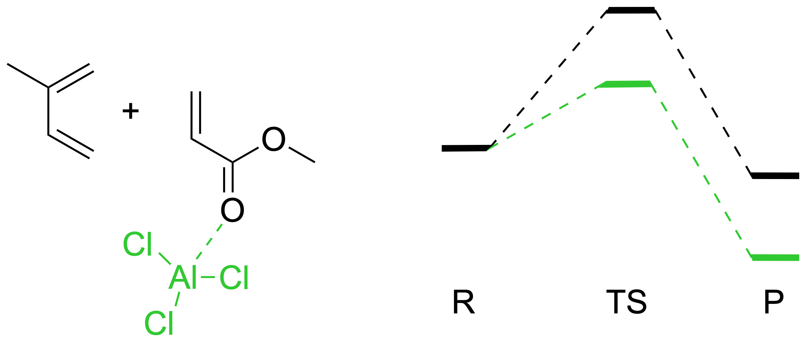
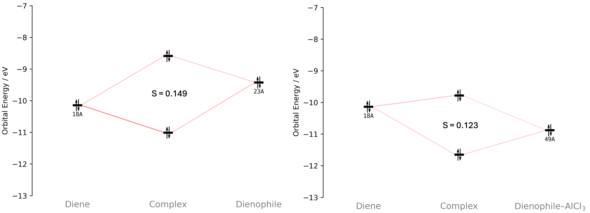
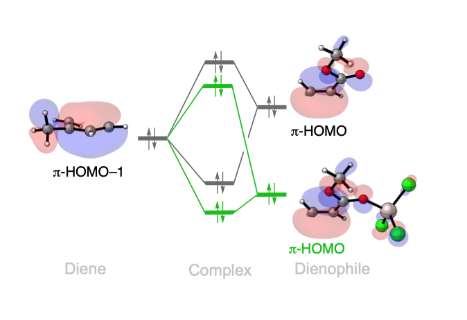

Lewis-Acid Catalysis: Diels-Alder
====================================================

Introduction
------------

   Reaction between isoprene (diene) and methyl acrylate (dienophile) with (green) and without (black) the AlCl\ :math:`_3` Lewis acid catalyst.

Catalysis of Diels-Alder reactions is an important tool in enhancing the reactivity and steering of the regiochemistry of the reactions. Lewis acids form one category of such catalysts and may bind to either the dienophile or diene to modify their electronic properties.\ [1]_\ [2]_ In this example we compare two Diels-Alder reactions between isoprene (diene) and methyl acrylate (dienophile), with one reaction being uncatalyzed, and the other catalyzed by the Lewis acid AlCl\ :math:`_3`\.\ [1]_\ [2]_

Usage
-----

Load the calculation
~~~~~~~~~~~~~~~~~~~~

1. Download the example files:
   :download:`TS_14.rkf <./../../examples/ExamplesFromPaper/LA_DielsAlder/TS_14.rkf>` and :download:`TS_AlCl3_14.rkf <./../../examples/ExamplesFromPaper/LA_DielsAlder/TS_AlCl3_14.rkf>`
2. Open PyOrbb and drag both ``TS_14.rkf`` and ``TS_AlCl3_14.rkf`` into the application.
3. Uncheck ``Show OI`` to hide the orbital interactions.
4. Double-click the "Ester" fragment label in the "TS_14.rkf" tab and rename it to ``Dienophile``.
5. Double-click the "Ester" fragment label in the "TS_AlCl3_14.rkf" tab and rename it to ``Dienophile-AlCl$_3$``.

The resulting diagrams are used in the analysis below and should both contain only one Pauli repulsive interactions.

.. tip::
   Fragment renaming accepts LaTeX input by encapsulating the LaTeX text with dollarsigns.

Obtaining the overlaps
~~~~~~~~~~~~~~~~~~~~~~

1. Click on the diene and dienophile FMOs while holding the shift key in the "TS_14.rkf" tab.
2. Click on the "Orbitals" tab on the right side of the diagram. It should now show you information about the selected orbitals.
3. Press the "Diene(18A) ± Dienophile(23A)" header to open the information section and note down the overlap (``Sij``).
4. Do the same for the diagram in the "TS_AlCl3_14.rkf" tab.

View the orbitals
~~~~~~~~~~~~~~~~~

1. Select an orbital in the interaction diagram.
2. Click the orbital-viewer control labelled ``φ``.

Inspect the orbitals on both fragments, using a viewing direction that
shows the two forming carbon–carbon bonds. Pay special attention to the orbital size of the |pi|-HOMOs of the dienophiles and make note of the amplitudes on the carbon atoms.

Analysis
--------

   Main Pauli repulsive interaction between the diene and the dienophile with (right diagram) and without (left diagram) the AlCl\ :math:`_3` catalyst. The overlap between the FMOs is also provided in the diagrams.

   Schematic orbital diagram with the corresponding orbitals.

AlCl\ :math:`_3` is a so-called Pauli-lowering catalyst. Due to the mixing of the catalyst with the dienophile, the amplitudes of the |pi|-HOMO on the dienophile carbon atoms arae reduced, leading to reduced overlap with the |pi|-HOMO–1 of the diene. The overlap values reflect this: the overlap between Diene(|pi|-HOMO-1) and Dienophile(|pi|-HOMO) is 0.149, which is reduced to 0.123 when the catalyst is introduced. 
As discussed in the main article,\ [3]_ and as reported in the literature,\ [1]_\ [2]_ the lowering of the overlap between these two |pi|-orbitals upon coordination of AlCl\ :math:`_3` causes the reduced Pauli repulsion and the reduced activation barrier.

References
----------

.. [1] \ P. Vermeeren, T. A. Hamlin, I. Fernández, and F. M. Bickelhaupt, "How Lewis Acids Catalyze Diels–Alder Reactions," Angewandte Chemie 132 (2020): 6260–6265, https://doi.org/10.1002/ange.201914582; 
.. [2] \ T. A. Hamlin, F. M. Bickelhaupt, and I. Fernández, "The Pauli Repulsion-Lowering Concept in Catalysis," Accounts of Chemical Research 54 (2021): 1972–1981, https://doi.org/10.1021/acs.accounts.1c00016.
.. [3] |main art|
