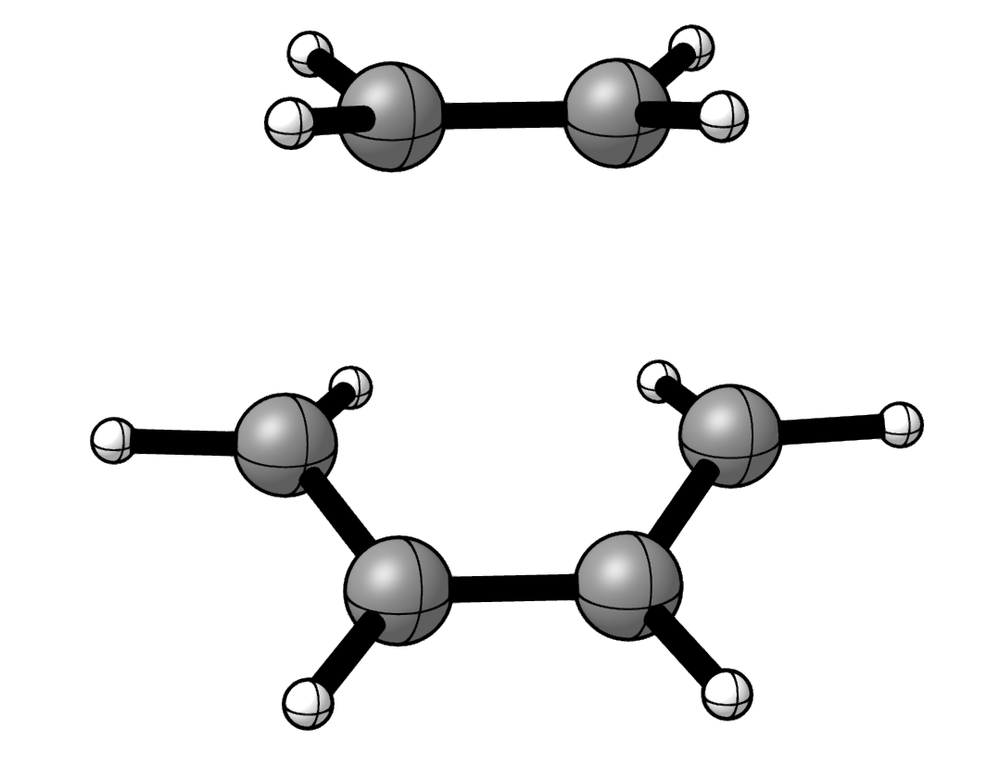
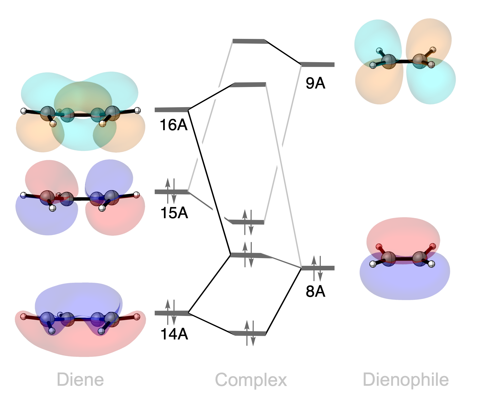

Diels–Alder Transition State
============================

Introduction
------------

   Transition state for the cycloaddition of buta-1,3-diene and ethylene.

The Diels–Alder reaction combines a conjugated diene and a dienophile to
form a new six-membered ring. Two new carbon–carbon bonds form as the |pi|-systems 
of the reactants reorganize.\ [2]_\ [3]_\ [4]_\ [5]_\ [6]_\ [7]_

In this example, we use PyOrbb to examine the transition state of the
reaction between buta-1,3-diene and ethylene. The analysis identifies
both normal and inverse electron demand mechanisms, together with an occupied–occupied
interaction that contributes to Pauli repulsion.\ [1]_

Usage
-----

Load the calculation
~~~~~~~~~~~~~~~~~~~~

1. Download the example file:
   :download:`DielsAlder.rkf <./../../examples/ExamplesFromPaper/DielsAlder/DielsAlder.rkf>`.
2. Open PyOrbb and drag the ``DielsAlder.rkf`` file into the application.

The interaction diagram shows the selected interactions between the
diene and dienophile FMOs.

View the orbitals
~~~~~~~~~~~~~~~~~

1. Select an orbital in the interaction diagram.
2. Click the orbital-viewer control labelled ``φ``.

Inspect the orbitals on both fragments, using a viewing direction that
shows the two forming carbon–carbon bonds. Compare the phases and
amplitudes at the terminal carbon atoms of the diene and at the two
carbon atoms of ethylene.

Analysis
--------

.. figure:: figures/DA_TS/DielsAlder.png
   :width: 75%
   :align: center
   :alt: Fragment orbitals involved in donation and Pauli repulsion at the Diels–Alder transition state.

   Selected orbital interactions between buta-1,3-diene and ethylene.

   Schematic orbital interaction diagram with the corresponding orbitals.

Donation from the diene
~~~~~~~~~~~~~~~~~~~~~~~

The normal-electron-demand (NED) mechanism involves donation from an
occupied |pi|-orbital on the diene into a virtual |pi|-orbital on the
dienophile. In the frontier-orbital description, this is the interaction
between the diene HOMO and the ethylene LUMO.

The diene HOMO has opposite phases at its terminal carbon atoms, matching
the phase pattern of the ethylene |pi|-antibonding LUMO. In the
cycloaddition geometry, these orbitals can overlap constructively at
both forming bonds. Their mixing provides a stabilizing contribution
to the interaction between the fragments.

Donation from the dienophile
~~~~~~~~~~~~~~~~~~~~~~~~~~~~

Donation also occurs in the opposite direction: an occupied |pi|-FMO
on ethylene interacts with a virtual |pi|-FMO on the diene. This is
the inverse-electron-demand (IED) channel, represented in the
frontier-orbital description by the ethylene HOMO and the diene LUMO.

The ethylene HOMO has the same phase on its two carbon atoms. The diene
LUMO likewise has matching phases at its terminal carbon atoms, allowing
constructive overlap at both forming bonds.

NED and IED describe the two directions of donation in this analysis.
Their presence does not mean that the reaction follows two separate
mechanisms, nor does it establish which channel is energetically more
important. Both contribute to the orbital interaction at the same
transition-state geometry.

Pauli repulsion
~~~~~~~~~~~~~~~

PyOrbb also identifies the interaction between the diene HOMO−1 and
the dienophile HOMO. The diene HOMO−1 is the in-phase combination of
the diene |pi|-system, while the ethylene HOMO is its occupied |pi|-bonding
orbital. Their spatial overlap contributes significantly to the Pauli
repulsion discussed in the main article.\ [1]_

Unlike the donation channels, both orbitals are occupied. Their overlap
requires the occupied orbitals of the combined system to become
orthogonal, giving rise to a destabilizing contribution. A favourable
phase pattern therefore does not, by itself, imply a stabilizing
interaction: orbital occupation matters as well.

This example shows both sides of the interaction between the approaching
reactants. Occupied–virtual mixing stabilizes the system, while
occupied–occupied overlap contributes to Pauli repulsion. Orbital plots
help identify these contributions, but their shapes alone do not give
their energetic balance or the overall activation barrier.

References
----------

.. [1] |main art|
.. [2] \I. Fernández, F. M. Bickelhaupt, "Deeper Insight into the Diels–Alder Reaction through the Activation Strain Model," *Chem. – Asian J\.*, **2016**, 3297–3304, DOI: https://doi.org/10.1002/asia.201601203.
.. [3] \A. Talbot, D. Devarajan, S. J. Gustafson, I. Fernández, F. M. Bickelhaupt, D. H. Ess, "Activation-Strain Analysis Reveals Unexpected Origin of Fast Reactivity in Heteroaromatic Azadiene Inverse-Electron-Demand Diels–Alder Cycloadditions," *J. Org. Chem.*, **2014**, 548–558, DOI: https://doi.org/10.1021/jo5025514.
.. [4] \I. Fernández, F. M. Bickelhaupt, "Origin of the “endo rule” in Diels-Alder reactions," *J. Comput. Chem\.*, **2013**, 371–376, DOI: https://doi.org/10.1002/jcc.23500.
.. [5] \E. H. Tiekink, P. Vermeeren, T. A. Hamlin, "Not antiaromaticity gain, but increased asynchronicity enhances the Diels–Alder reactivity of tropone," *Chem. Comm\.*, **2023**, 3703–3706, DOI: https://doi.org/10.1039/d3cc00512g.
.. [6] \P. Vermeeren, T. A. Hamlin, F. M. Bickelhaupt, "Origin of asynchronicity in Diels–Alder reactions," *Phys. Chem. Chem. Phys\.*, **2021**, 20095–20106, DOI: https://doi.org/10.1039/d1cp02456f.
.. [7] \K. N. Houk, F. Liu, Z. Yang, J. I. Seeman, "Evolution of the Diels–Alder Reaction Mechanism since the 1930s: Woodward, Houk with Woodward, and the Influence of Computational Chemistry on Understanding Cycloadditions," *Angew. Chem. Int. Ed\.*, **2021** 12660–12681, DOI: https://doi.org/10.1002/anie.202001654.