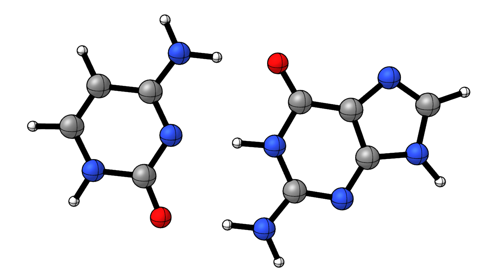
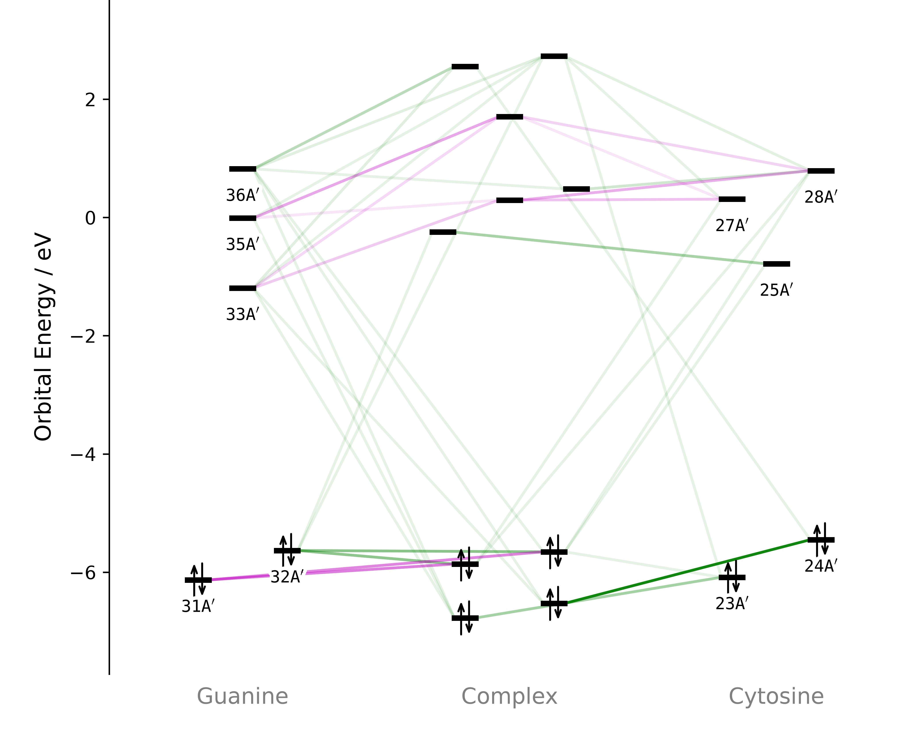
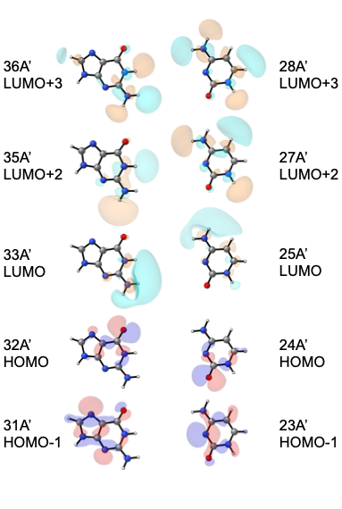
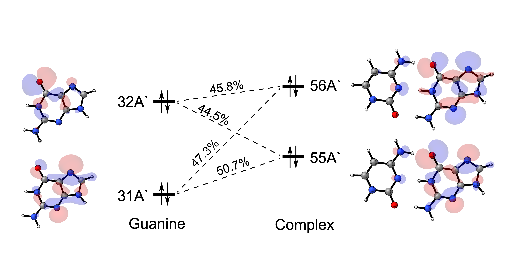

Hydrogen Bonding in the Guanine–Cytosine Base Pair
==================================================

Introduction
------------

   The guanine–cytosine base pair.

Hydrogen bonds involve both electrostatic and orbital interactions. The
orbital contribution includes interactions between occupied lone-pair
orbitals on the hydrogen-bond acceptor and virtual N–H antibonding orbitals
on the donor. These interactions can be weak and involve several fragment
molecular orbitals (FMOs), making them difficult to identify manually.

In this example, we use PyOrbb to examine the guanine–cytosine base pair
studied by Fonseca Guerra et al.\ [1]_ The selected orbitals reveal the
hydrogen-bonding interactions and the accompanying polarization of the
fragments.

Usage
-----

Load the calculation
~~~~~~~~~~~~~~~~~~~~

1. Download the example file:
   :download:`Guanine_Cytosine.rkf <./../../examples/ExamplesFromPaper/HydrogenBond/Guanine_Cytosine.rkf>`.
2. Open PyOrbb and drag ``Guanine_Cytosine.rkf`` file into the application.
3. Uncheck ``Show PR`` to hide the Pauli-repulsive interactions.
4. Adjust the green orbital-interaction slider until the displayed cumulative
   fraction is **87.5%**.

The resulting selection is used in the analysis below. Hiding the
Pauli-repulsive interactions only changes the display and we disable 
it because we are currently only interested in the orbital interactions.

View the orbitals
~~~~~~~~~~~~~~~~~

1. Select an orbital in the interaction diagram.
2. Click the orbital-viewer control labelled ``φ``.

The PyOrbb viewer opens with options for displaying the orbital. Repeat
these steps for the other selected FMOs. Using the same viewing direction
and isosurface value makes it easier to compare their shapes and spatial
extent.

Analysis
--------

   Orbital interaction diagram at a cumulative fraction of 87.5% for orbital interactions.

   Orbital isosurfaces of the selected FMOs.

   

Hydrogen-bonding orbitals
~~~~~~~~~~~~~~~~~~~~~~~~~

At this setting, the selected set contains 10 A′-symmetric FMOs. These
orbitals are symmetric with respect to reflection in the plane of the base
pair and are involved in |sigma|-type interactions.

Visualization of the FMOs reveals that the virtual FMOs show N–H antibonding character. All selected occupied FMOs
except Guanine(31A′) show nitrogen- or oxygen-lone-pair character. These
features are consistent with the hydrogen-bonding orbitals identified by
Fonseca Guerra et al.\ [1]_

The relevant interfragment interactions couple a lone-pair orbital on one
base with an N–H antibonding orbital on the other. In the orbital viewer,
look for a lone-pair lobe directed towards the hydrogen-bond donor and
antibonding character across the corresponding N–H bond. Their orientation
and spatial overlap help explain how the orbitals interact across the
hydrogen bond.

Some FMOs extend over several atoms, so they need not correspond to a
single hydrogen bond. Orbital plots are useful for assigning their
character, but do not by themselves establish the strength of an
interaction. Similarly, the displayed cumulative fraction of 87.5% should
not be read as a percentage of the total hydrogen-bond energy.

Polarization due to Guanine(31A′)
~~~~~~~~~~~~~~~~~~~~~~~~~~~~~~~~~

Guanine(31A′) is included for a different reason. PyOrbb adds this FMO
during sanitization to satisfy the closed-interaction requirements
described in the main article.\ [2]_ It is not assigned a direct
hydrogen-bonding role in this analysis.

   Mixing diagram showing the intrafragment polarization of guanine due to its interaction with cytosine. Each connection has its corresponding Mulliken contribution.

   
Instead, Guanine(31A′) mixes with Guanine(32A′) to form the base
pair's HOMO and HOMO−1 molecular orbitals. This mixing within guanine
is due to the polarization induced by its interaction with cytosine.
Inspection of the Mulliken contributions show that the HOMO and HOMO-1 are 
built up of roughly equal parts of the Guanine(31A′) and Guanine(32A′) FMOs.
There is also a small amount of mixing of the Cytosine FMOs visible in the 
HOMO and HOMO-1 of the base pair.

The selected interactions therefore contains both the orbitals directly involved
in interfragment hydrogen bonding and an additional orbital needed to
describe the associated polarization within guanine.

References
----------

.. [1] C. Fonseca Guerra, F. M. Bickelhaupt, J. G. Snijders, E. J. Baerends, “The Nature of the Hydrogen Bond in DNA Base
   Pairs: The Role of Charge Transfer and Resonance Assistance,”
   *Chem. – A Eur. J\.*, **1999**, 3581–3594.
   DOI: `10.1002/(sici)1521-3765(19991203)5:12<3581::aid-chem3581>3.0.co;2-y <https://doi.org/10.1002/(sici)1521-3765(19991203)5:12%3C3581::aid-chem3581%3E3.0.co;2-y>`_.

.. [2] |main art|
