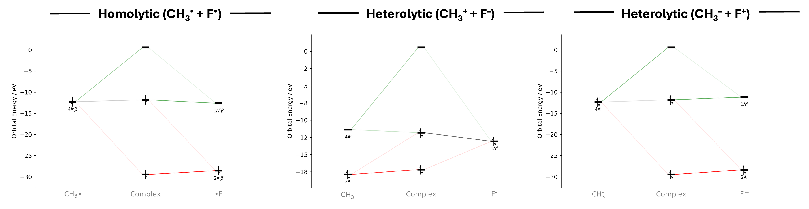

Hetero- and Homolytic Bond Cleavage of Fluoromethane
=======================================================

Introduction
------------

There are multiple ways of computing bond dissociation energies when using the fragment approach in ADF. Specifically, a choice must be made as to the electronic configuration of the fragments. In this example we examing the C–F bond formation of methyl fluoride following the work of Vermeeren, et al.\ [1]_ In this work the researchers model three different bond cleavage pathways. Homolytic bond cleavage, with each fragment taking one electron, heterolytic bond cleavage with the fluoride fragment taking both electrons (hetero1), and the inverse heterolytic bond cleavage with methyl taking both electrons (hetero2).

.. note::
   You should use effective energies when investigating systems with charged fragments. These FMO energies incorporate the effect of the strong external potential of the other charged fragment and provide a better physical description of the orbital interactions between the fragments. See the supporting information of the main article for more information on the use of effective energies.

Usage
-----

Loading the results
~~~~~~~~~~~~~~~~~~~

1. Download the example files:
   :download:`Homo.rkf <./../../examples/ExamplesFromPaper/BondCleavage/Homo.rkf>`, :download:`Hetero1.rkf <./../../examples/ExamplesFromPaper/BondCleavage/Hetero1.rkf>`, and :download:`Hetero2.rkf <./../../examples/ExamplesFromPaper/BondCleavage/Hetero2.rkf>`
2. Open PyOrbb and drag the files into the application.
3. Click the "Energy Type" button and select the "Effective" energy type for each opened tab. There should be a large change in the orbital interaction diagram for the heterolytic bond cleavage cases.

Obtaining interaction data
~~~~~~~~~~~~~~~~~~~~~~~~~~

1. In the diagram, click the orbitals that are interacting while holding shift.
2. On the right side of the diagram select the "Orbitals" tab and click on the interaction header to open the information panel.

Note down the overlap (``Sij``) and energy gap (``|εi - εj``).

Analysis
--------

   Main interaction diagrams for the homolytic and heterolytic bond cleavage pathways.

PyOrbb recovers the expected mechanism in each bond cleavage pathway. In all three cases the main orbital interaction involves the methyl 4A' and fluorine 1A" FMOs, which, regardless of the electronic configuration have very similar effective energy gaps and overlaps. Still, the trend in stabilizing effect (\ :math:`\frac{S_{ij}^2}{|\varepsilon_i - \varepsilon_j|}`\ ) due to the orbital interactions diminishes from the homolytic to the heterolytic1 to the heterolytic2 pathways, and matches the trend in the bond dissociation energies.\ [1]_

References
----------

.. [1] \ P. Vermeeren, F. M. Bickelhaupt, "Nature and stability of the chemical bond in H\ :math:`_3`\ C–XH\ :math:`_n`\  (XH\ :math:`_n`\  = CH\ :math:`_3`\ , NH\ :math:`_2`\ , OH, F, Cl, Br, I)", *J. Chem. Phys\.*, **2024**, 044305, DOI: https://doi.org/10.1063/5.0245218.
.. [2] |main art|