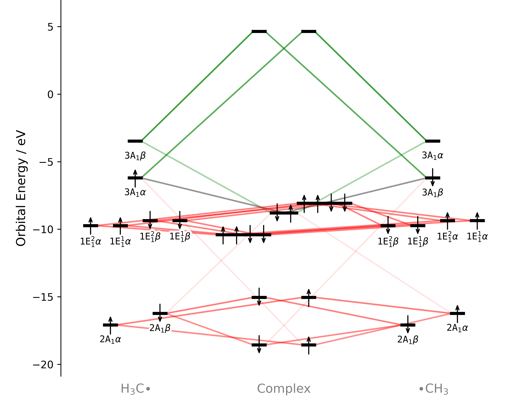
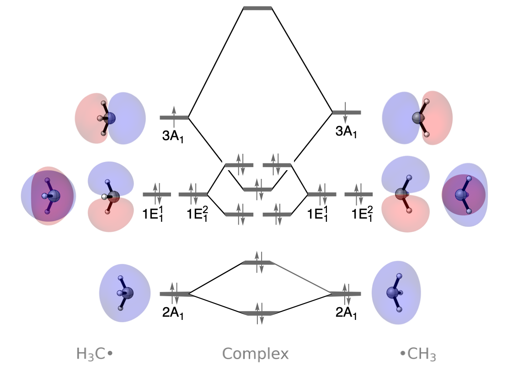

C–C Bond Formation in Ethane
============================

Introduction
------------

Understanding the formation of bonds is often an important task in computational chemistry and can aid in the understanding of bond strengths and nucleophilicities. In this example we examine the homolytic bond-formation of the C-C bond in ethane using PyOrbb, following the example by Rodrigues Silva, et al.\ [1]_ 

   Ethane cleaved along its C–C bond into two methyl fragment with opposite spin-polarizations.

.. note::
   This calculation was performed in an unrestricted manner with one methyl fragment having spin-polarization of +1 and the other –1. Enabling unrestricted calculations leads to orbitals being separated into their alpha- and beta-spin components.

Usage
-----

Load the calculation
~~~~~~~~~~~~~~~~~~~~

1. Download the example file:
   :download:`Ethane.rkf <./../../examples/ExamplesFromPaper/HomolyticEthane/Ethane.rkf>`.
2. Open PyOrbb and drag ``Ethane.rkf`` file into the application.
3. Drag the "Left" and "Right" fragment labels such that "Left" is on the left side and "Right" on the right.
4. Double click "Left" fragment label on the x-axis and rename it to ``H$_3$C$\bullet$``.
5. Rename the "Right" fragment label to ``$\bullet$CH$_3$``.
6. Adjust the red Pauli-repulsion slider until the displayed cumulative
   fraction is **96.9%**.

The resulting selection is used in the analysis below.

.. tip::
   Fragment renaming accepts LaTeX input by encapsulating the LaTeX text with dollarsigns.

View the orbitals
~~~~~~~~~~~~~~~~~

1. Select an orbital in the interaction diagram.
2. Click the orbital-viewer control labelled ``φ``.

The PyOrbb viewer opens with options for displaying the orbital. Repeat
these steps for the other selected FMOs. Using the same viewing direction
and isosurface value makes it easier to compare their shapes and spatial
extent.

Analysis
--------

   Orbital interaction diagram at a cumulative fraction of 96.9% for Pauli repulsive interactions.

   Schematic orbital interaction diagram including the orbitals that are involved in the interaction.

Orbital interactions
~~~~~~~~~~~~~~~~~~~~

We find that PyOrbb identifies one main |sigma|-symmetric stabilizing orbital interaction corresponding to the |sigma|\ (out) orbitals of the methyl fragments. The interaction exists for both spin-states and is therefore an electron-pair bond, where a new bond is formed by the interaction of two singly occupied orbitals on each fragment.

Pauli repulsions
~~~~~~~~~~~~~~~~

Besides the stabilizing |sigma|-symmetric stabilizing orbital interactions, there are destabilizing |sigma|- and |pi|-symmetric Pauli repulsive interactions. The main destabilizing interactions also involve the 3A\ :math:`_1` FMOs, which can mix with the 2A\ :math:`_1` FMOs with very significant overlaps of 0.368. The 2A\ :math:`_1` FMOs also interact with each other with overlaps of 0.163. Finally, there is strong mixing between the |pi|-symmetric 1E\ :math:`^1_1` and 1E\ :math:`^2_1` FMOs. These have significant overlap of 0.129. 

Most of the stabilizing and destabilizing interactions originate within the |sigma|-symmetry, with a large Pauli repulsive contribution from |pi|-interactions.

References
----------

.. [1] \ D. Rodrigues Silva, E. Blokker, J. M. Van Der Schuur, T. A. Hamlin, and F. M. Bickelhaupt, "Nature and strength of group-14 A–A′ bonds," Chemical Science 15 (2024): 1648–1656, https://doi.org/10.1039/d3sc06215e.
.. [2] |main art|