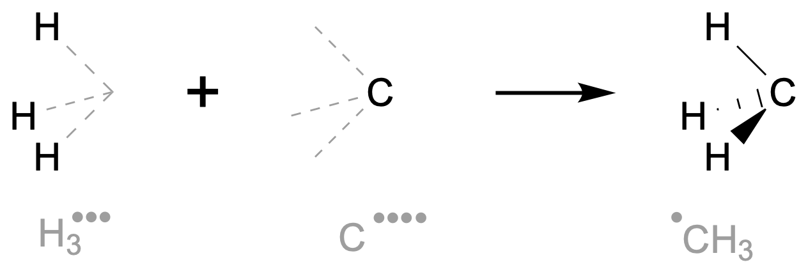
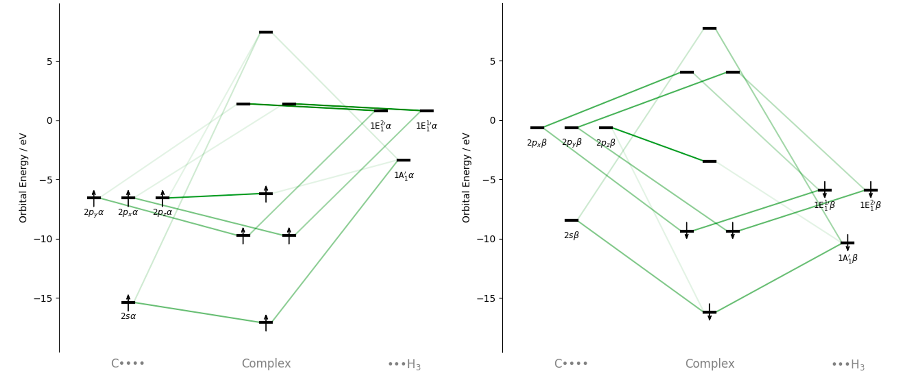
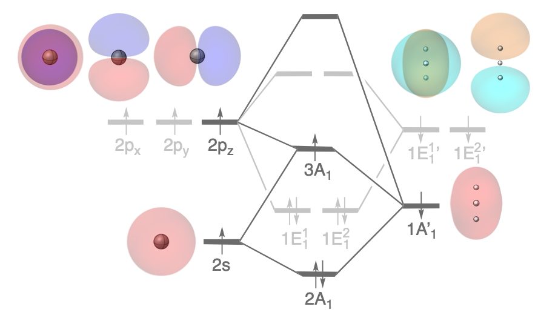

Formation of the Methyl Radical
===============================

Introduction
------------

   Formation of the methyl radical from the H\ :math:`_3^{\bullet\bullet\bullet}` and C\ :math:`^{\bullet\bullet\bullet\bullet}` fragments.

Bond formation within molecules is an important topic of research and is often done using Kohn-Sham MO theory. 
By examining the mixing of fragment orbitals one can rationalize the shapes and energies of their orbitals and how they influences their interaction with other molecules.
In this example we investigate the formation of the methyl radical fragment from the `C–C bond formation example <Homolytic_Ethane.html>`_. In this system we fragment the methyl radical into the H\ :math:`_3^{\bullet\bullet\bullet}` and C\ :math:`^{\bullet\bullet\bullet\bullet}` fragments, following the work of Rodrigues Silva.\ [1]_

.. note::
   This calculation was performed in an unrestricted manner with the H\ :math:`_3^{\bullet\bullet\bullet}` having spin-polarization of –3 and the C\ :math:`^{\bullet\bullet\bullet\bullet}` having a spin-polarization of +4. Together this leads to a methyl radical with a spin-polarization of +1. Enabling unrestricted calculations leads to orbitals being separated into their alpha- and beta-spin components.

Usage
-----

Load the calculation
~~~~~~~~~~~~~~~~~~~~

1. Download the example files:
   :download:`Methyl.rkf <./../../examples/ExamplesFromPaper/HomolyticEthaneMethyl/Methyl.rkf>`
2. Open PyOrbb and drag `Methyl.rkf` into the application.
3. Uncheck ``Show PR`` to hide the Pauli repulsions.
4. Double click the "C" fragment label on the x-axis and rename it to ``C$\bullet\bullet\bullet\bullet$``.
5. Rename the "Right" fragment label to ``H$_3 \bullet\bullet\bullet\bullet$``.
6. Adjust the green orbital interacation slider until the displayed cumulative
   fraction is **98.8%**.

.. tip::
   Fragment renaming accepts LaTeX input by encapsulating the LaTeX text with dollarsigns.

Filter by spin-state
~~~~~~~~~~~~~~~~~~~~

Unrestricted calculations separate the orbitals into their |alpha|- and |beta|-spins, effectively doubling the number of important interactions. PyOrbb may therefore produce a diagram that is difficult to understan and it could be of help to investigate the spin-states separately.

1. Click the "Orbitals" button in the right-bottom corner of the application.
2. Click the "Spins" button and check or uncheck the spin-states you would like to see.

Analysis
--------

   Orbital interaction diagram at a cumulative fraction of 98.8% for orbital interactions. For clarity, the diagram was separated into the |alpha|-spin (left) and |beta|-spin (right) interactions.

   Schematic orbital interaction diagram including the orbitals that are involved in the interaction. Dark grey orbitals and connections show the |sigma|-symmetric interactions, while the light grey ones show the |pi|-symmetric ones.

In the related `C–C bond formation of ethane <Homolytic_Ethane.html>`_ from two methyl radical fragments we saw that the main orbital interactions and Pauli repulsive interactions involve the |sigma|-symmetric orbitals 2A\ :math:`_1` and 3A\ :math:`_1` of the methyl fragments. There is also a contribution to the Pauli repulsion by the filled |pi|-symmetric orbitals 1E\ :math:`^1_1` and 1E\ :math:`^2_1`. PyOrbb identifies the interactions that form these orbitals, as well as their antibonding combinations.

Formation of the |sigma|-symmetric MOs
~~~~~~~~~~~~~~~~~~~~~~~~~~~~~~~~~~~~~~

The |sigma|-type orbitals 2A\ :math:`_1` and 3A\ :math:`_1` are formed by the interaction of three FMOs, namely the 2s and 2p\ :math:`_z` FMOs of the carbon atom with the 1A'\ :math:`_1` FMO of the hydrogen atoms, which is the bonding interaction of its hydrogen 1s orbitals. The methyl HOMO is formed by both the bonding combination of the carbon 2p\ :math:`_z`  and hydrogen 1A'\ :math:`_1` FMOs and the antibonding combination of the carbon 2s and hydrogen 1A'\ :math:`_1` FMOs. The 2A\ :math:`_1` MO is the bonding combination of the mixing of the carbon 2s and hydrogen 1A'\ :math:`_1` FMOs.

Formation of the |pi|-symmetric MOs
~~~~~~~~~~~~~~~~~~~~~~~~~~~~~~~~~~~

The |pi|-symmetric MOs of the methyl radical are formed by two degenerate interactions between the |pi|-symmetric FMOs. These interactions involve the carbon 2p\ :math:`_x` and 2p\ :math:`_y` FMOs with the corresponding 1E\ :math:`^{1,}_1` and 1E\ :math:`^{2,}_1` FMOs of hydrogen. These FMOs are exactly oriented to be able to interact along the x- and y-axes.

.. note::
   Be careful of the complex and fragment orientations when performing these types of investigations yourself. If the methyl radical was not oriented exactly on the z-axis the mixing between the various p-orbitals of carbon and the hydrogen FMOs would not be directly separable into |sigma|- and |pi|-symmetries, making the analysis much more difficult.

References
----------

.. [1] \ D. Rodrigues Silva, E. Blokker, J. M. Van Der Schuur, T. A. Hamlin, F. M. Bickelhaupt, "Nature and strength of group-14 A–A′ bonds", *Chem. Sci\.*, **2024**, 1648–1656, DOI: https://doi.org/10.1039/d3sc06215e.
.. [2] |main art|
