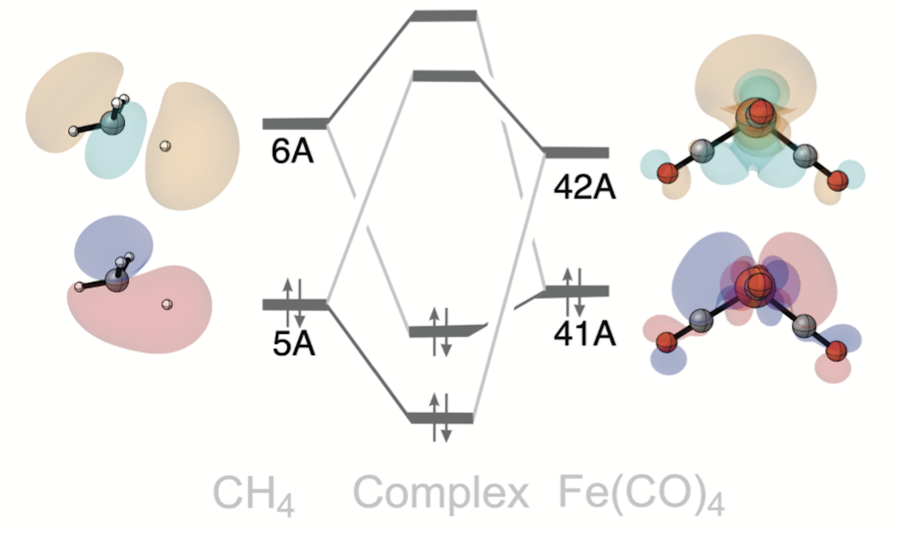

Oxidative Addition: C–H Bond Activation by Fe(CO)\ :sub:`4`
===========================================================

Introduction
------------

   Transition state for the oxidative addition of a methane C–H bond
   to Fe(CO)\ :sub:`4`.

Oxidative addition is a common step in transition-metal catalysis. In the
reaction considered here, Fe(CO)\ :sub:`4` activates a C–H bond of methane,
leading to cleavage of the bond and the formation of the oxidative addition product.

In this example, we examine the oxidative addition
transition state studied by Sun et al. [1]_ The analysis identifies two
complementary interactions: donation from methane to Fe(CO)\ :sub:`4` and
backdonation from Fe(CO)\ :sub:`4` to methane. [2]_

Usage
-----

Load the calculation
~~~~~~~~~~~~~~~~~~~~

1. Download the example file:
   :download:`Oxidative_Addition.adf.rkf <./../../examples/ExamplesFromPaper/CoordinationBondFeCO4CH4/FeCO4_CH4.rkf>`.
2. Open PyOrbb and drag the ``.rkf`` file into the application.
3. Uncheck ``Show PR`` to hide the Pauli-repulsive interactions.

Two main orbital interactions should appear in the interaction diagram.

View the orbitals
~~~~~~~~~~~~~~~~~

1. Select an orbital in the interaction diagram.
2. Click the orbital-viewer control labelled ``φ``.

The PyOrbb viewer opens with options for displaying the orbital. Inspect
the methane and Fe(CO)\ :sub:`4` orbitals involved in each interaction,
using a viewing direction that clearly shows the activating C–H bond
and the iron centre.

Analysis
--------

.. figure:: figures/oxadd/OxAdd.png
   :width: 75%
   :align: center
   :alt: Selected fragment orbitals involved in C–H bond activation by Fe(CO)\ :sub:`4`.

   Orbital interaction mechanism identified by PyOrbb.

   Schematic drawing of the orbital interaction mechanism including the involved orbitals.

PyOrbb identifies two strong interactions between the fragments that were also identified by Sun, et al.
The first is between the occupied CH\ :sub:`4`\ (5A)
and the virtual Fe(CO)\ :sub:`4`\ (42A) FMOs. This is the C–H |sigma|-donation interaction: electrons
are donated from the bonding orbital of methane to the iron fragment.
The other interaction occurs between the occupied
Fe(CO)\ :sub:`4`\ (41A) and the virtual CH\ :sub:`4`\ (6A) FMOs and is the backdonation interaction 
with electrons being donated from Fe(CO)\ :sub:`4` into CH\ :sub:`4`.

References
----------

.. [1] X. Sun, M. V. J. Rocha, T. A. Hamlin, J. Poater, and F. M.
   Bickelhaupt, "Understanding the differences between iron and
   palladium in cross-coupling reactions," *Phys. Chem.
   Chem. Phys.* **2019**, 9651–9664.
   DOI: `10.1039/C8CP07671E <https://doi.org/10.1039/c8cp07671e>`_.

.. [2] |main art|
